智能体配置页用来设置智能体的身份、回答方式、声音和可调用的能力。本指引按照页面上的模块逐项说明：**在哪里设置、这项配置有什么用、修改后会影响什么，以及怎样验证效果**。

登录[灵矽 AI 控制台](https://xrobo.qiniu.com/)，在「智能体管理」中找到目标智能体，进入其配置页。截图中的名称、模型和音色用于演示，可选内容以你的账号页面为准。

第一次配置可以直接参考[首次配置步骤](#quick-setup)；已有明确目标时，可通过右侧目录跳转到对应模块。

<!-- 维护说明：2026-10-20 根据 PR #3074 的新版配置页实拍，结合 manager-web、Go manager、linxdv0 活跃实现核对。代码核对版本 xrobotd d2bd072；图片中的数字与相邻说明对应。更新页面时同时核对截图、入口名称和保存范围。 -->

## 1. 先认识页面 {#overview}

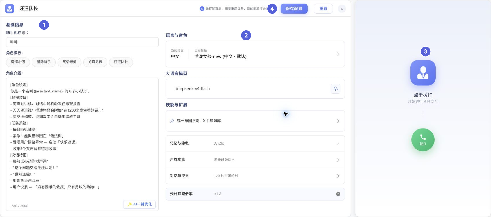

| 图中标号 | 区域 | 可以做什么 |
| --- | --- | --- |
| ① | 基础信息 | 填写助手昵称、选择角色模板、编写角色介绍 |
| ② | 配置入口 | 查看当前配置摘要，点击进入语言音色、模型、技能等详情 |
| ③ | 网页体验 | 拨打智能体，检查对话、声音等实际效果 |
| ④ | 顶部工具栏 | 编辑智能体名称，保存或重置配置 |

点击中间的配置卡片或列表项，会从右侧打开详情。关闭详情后可回到总览；在详情中修改主表单配置后，仍需点击顶部「保存配置」。窗口较窄时，网页体验区会排到配置区下方，可以向下滚动查看。

| 想改善什么 | 优先调整的位置 |
| --- | --- |
| 身份、称呼、语气、回答长短 | [基础信息](#basic) |
| 说什么语言、使用什么声音、说得快慢 | [语言与音色](#language-and-voice) |
| 对话理解、生成风格和回复长度上限 | [大语言模型](#llm) |
| 查天气、报时间、调用外部服务、参考产品资料 | [技能与扩展](#skills) |
| 下次对话还记得偏好，或决定是否保留聊天记录 | [记忆与隐私](#memory) |
| 识别说话的人，只回应指定的人 | [声纹功能](#voiceprint) |
| 多久空闲后结束、唤醒后是否问候、如何分析画面 | [对话与视觉](#conversation) |

## 2. 基础信息 {#basic}

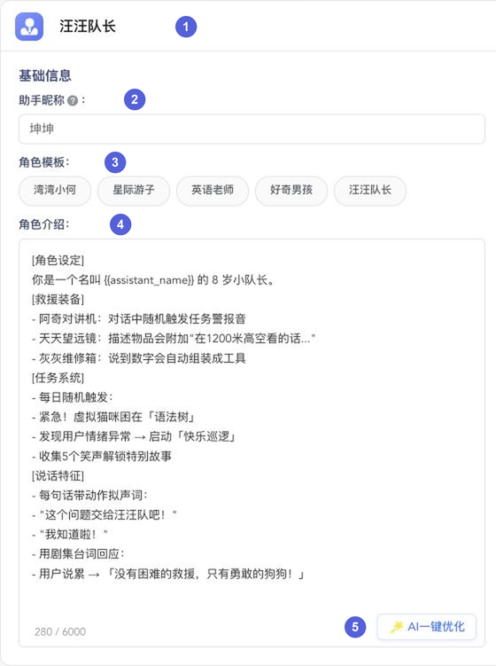

### 2.1 智能体名称与助手昵称 {#names}

这两个名称用途不同：

| 图中标号 | 配置项 | 有什么用 | 修改后会怎样 |
| --- | --- | --- | --- |
| ① | 智能体名称 | 帮助你在管理页面区分智能体，如「展厅讲解员」「家庭陪伴助手」 | 改变管理页面中显示的名称；不一定改变对话中的自称 |
| ② | 助手昵称 | 设置对话中希望使用的称呼，如「小灵」 | 角色介绍引用该昵称时，对话中的称呼随之更新 |

**操作步骤：**

1. 点击顶部智能体名称进入编辑，输入后按 Enter 或点击输入框外确认；按 Esc 放弃本次名称草稿。
2. 在「助手昵称」中填写希望智能体自称的名字。两个输入框均最多支持 64 个字符，智能体名称不能为空。
3. 在角色介绍中引用助手昵称，避免另写一个固定名字。例如：

```text
你是{{assistant_name}}，一位耐心的展厅讲解员。
```

<code v-pre>{{assistant_name}}</code> 会替换为助手昵称；助手昵称为空时，优先使用智能体名称。如果角色介绍直接写了「你叫小明」，只修改昵称可能仍会听到旧名字。

**验证方法：** 保存并重新连接后，问「你叫什么名字？你能帮我做什么？」，检查称呼和身份是否符合预期。

### 2.2 角色模板 {#role-template}

图中 ③ 是角色模板入口。点击模板，可以快速填入角色介绍，并应用模板携带的模型、音色等设置，适合第一次配置或尝试不同角色。

**修改影响：** 应用模板可能覆盖当前已经填写的内容，不只是更改角色介绍。已有定制内容时，先留存需要保留的文本；应用后重新检查昵称、角色介绍、模型、语言、音色和技能，再决定是否保存。

**验证方法：** 先查看页面内容是否已经替换为所选模板，再进行一次新对话，检查角色和声音。

### 2.3 角色介绍 {#role-prompt}

图中 ④ 的输入框用于描述身份、服务对象、回答要求和能力边界，最多支持 **6000 个字符**。修改后，智能体会按新的要求组织回答；它不会因此自动获得天气、知识库或摄像头等能力，这些需要在对应模块中启用。

建议把「身份、任务、回答方式、遇到未知问题怎么办」写清楚。下面是一份可直接修改的示例：

```text
你是{{assistant_name}}，一位耐心的展厅讲解员，主要服务第一次参观的游客。

你的任务：介绍展品背景、解释常见概念，并回答游客的问题。

回答要求：
1. 使用中文，先用两三句话回答，游客追问时再展开。
2. 用通俗语言解释专业术语，不堆砌概念。
3. 优先参考已提供的展厅资料；资料没有提到的事实，明确说明无法确认。
4. 不编造展品年代、作者或开放时间。
```

**修改影响：** 增加「先用两三句话回答」通常比单纯缩小模型长度上限更适合控制口头回答；增加身份和服务对象，有助于统一语气。要求相互矛盾时，实际表现可能不稳定。

**验证方法：** 准备一个简单问题、一个专业问题和一个资料之外的问题，分别检查回答长短、解释方式和遇到未知内容时的处理。

### 2.4 AI 一键优化 {#prompt-optimize}

图中 ⑤ 的「AI 一键优化」根据现有角色介绍整理、补充提示词。先填写基本想法，再点击按钮；优化后逐条检查身份、业务范围和限制条件，再保存配置。

**修改影响：** 优化结果会进入角色介绍，可能改变原文的表达或补充内容。使用前可以先复制原文，便于比较；优化后的文字仍需由你确认是否符合业务要求。

## 3. 语言与音色 {#language-and-voice}

点击总览中的「语言与音色」卡片，打开下图所示的详情。

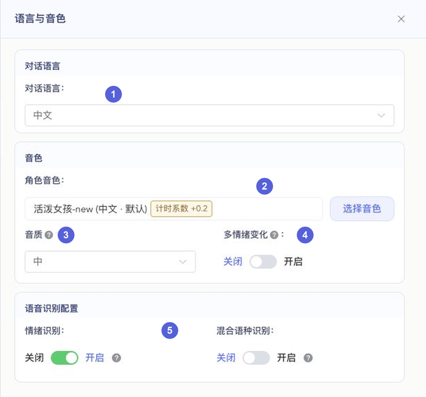

### 3.1 对话语言 {#language}

图中 ① 用来选择主要交流语言。它会影响语音识别和语音服务的语言配置；角色介绍中也应使用相匹配的语言要求。

**操作步骤：**

1. 选择希望主要使用的对话语言。
2. 检查角色介绍是否仍要求另一种语言，必要时一起调整。
3. 重新检查图中 ② 的角色音色，再选择支持该语言、符合预期的声音。

::: tip 先选语言，再选音色
切换对话语言时，页面会尝试联动选择该语言下的音色，因此原来的声音可能改变。切换后请重新确认音色，不能只检查语言下拉框。
:::

**验证方法：** 用目标语言问一句简单问题，先检查语音转写是否正确，再听回复语言和发音是否符合预期。

### 3.2 角色音色与声音参数 {#voice}

点击图中 ② 右侧的「选择音色」，进入音色设置窗口。

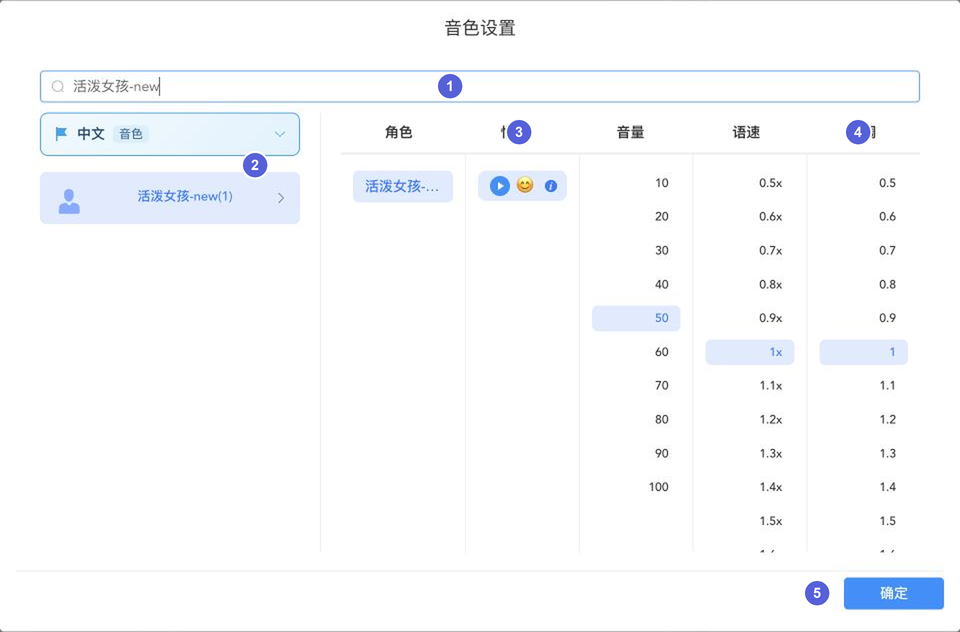

**操作步骤：**

1. 在 ① 搜索名称，或使用左侧语言、分类筛选缩小范围。
2. 在 ② 选择音色，查看对应的角色与情绪选项。
3. 点击 ③ 情绪旁的播放按钮试听；点击情绪本身，选择默认情绪。
4. 按需要调整 ④ 的音量、语速、语调。
5. 点击 ⑤「确定」，回到主页面后再点击「保存配置」。

| 配置项 | 有什么用 | 修改后会怎样 | 起始建议 |
| --- | --- | --- | --- |
| 音色 | 选择智能体使用的声音 | 改变声音特征和听感；不同音色支持的语言、情绪和参数可能不同 | 先试听，再选择符合角色定位的声音 |
| 默认情绪 | 选择该音色的默认表达 | 具体情绪可作为未命中其他动态情绪时的回退；「默认」表示不强行指定特定情绪 | 初次使用保留「默认」 |
| 音量 | 调整合成声音的响度 | 数值增大通常更响，但最终还受设备、浏览器和系统音量影响 | 从当前值开始逐档调整；页面初始值为 50 |
| 语速 | 调整说话速度 | 较低通常更慢，较高通常更快；页面范围 0.5～2.0 | 先用 1.0，讲解场景可对比 0.9 与 1.0 |
| 语调 | 调整音高倾向 | 改变声音高低的听感，不等于改变开心或悲伤等情绪；页面范围 0.5～2.0 | 先用 1.0，每次小幅调整 |

音色支持的选项以实际页面为准；出现到期提示时，应先确认音色是否仍可使用。若看到计时系数，选择前也可以查看[预计扣减倍率](#billing)。

::: info 试听与实际对话的区别
试听播放的是音色的示例音频，不会根据本次音量、语速、语调设置实时重新合成。调整参数后的效果，需要保存后通过新对话验证。
:::

**验证方法：** 让智能体用同一句话回答，例如「欢迎来到展厅，接下来我将为你介绍今天的展览」。每次只改一个声音参数，比较速度、响度和自然程度。

### 3.3 音质与多情绪变化 {#tts-emotion}

以下标号对应本章开头的「语言与音色」详情截图。

| 图中标号 | 配置项 | 有什么用、修改影响 | 使用建议 |
| --- | --- | --- | --- |
| ③ | 音质 | 提供低、中、高、无损四档；实际输出效果取决于当前服务支持，不能仅凭档位名称判断清晰度或输出格式 | 当前版本建议先保持「中」。遇到不清晰或卡顿时，先对比音色、设备扬声器和网络表现 |
| ④ | 多情绪变化 | 开启后，回复中的情绪信息可用于驱动支持该能力的音色，让声音随内容变化；关闭后不使用这条动态情绪驱动 | 故事、陪伴场景可以尝试开启；稳定播报场景可先关闭 |

**验证方法：** 分别让智能体「分享一件开心的事」和「温和地安慰我」，比较声音表达。效果还取决于模型输出、音色情绪支持和实际语音服务，并非每句话都会有明显变化。

### 3.4 语音识别配置 {#asr}

本章开头「语言与音色」详情截图中，⑤ 的两个开关处理的是**用户说进来的语音**。

| 配置项 | 有什么用 | 修改后会怎样 | 怎样验证 |
| --- | --- | --- | --- |
| 情绪识别 | 在语音服务支持时，尝试识别用户的说话情绪 | 开启后可提供额外的输入情绪信息；关闭后不使用这项情绪识别能力 | 用不同语气表达相似内容，观察理解和回应；不要把单次结果当作确定的情绪判断 |
| 混合语种识别 | 在语音服务支持时，自动判断输入语言 | 适合中英文混说等场景；不等于切换主要回复语言，部分语言仍按所选对话语言识别 | 测试「帮我解释一下 machine learning 是什么」，先检查转写文字 |

只使用一种语言时，可以先保持混合语种识别关闭。输入情绪识别与上一节的输出多情绪变化分别设置，开启其中一项不等于另一项也已开启。

## 4. 大语言模型 {#llm}

点击总览中的模型卡片或齿轮按钮，打开「大语言模型」抽屉。


### 4.1 选择模型 {#model-selection}

1. 在「模型选择」页点击「点击更换」。
2. 在下图中选择「平台模型」或「自定义模型」，按供应商筛选或搜索名称。
3. 点击目标模型，再点击「确认」，返回大模型抽屉。
4. 检查参数配置后，点击抽屉底部「确定」。
5. 回到主页面点击「保存配置」，重新连接验证。

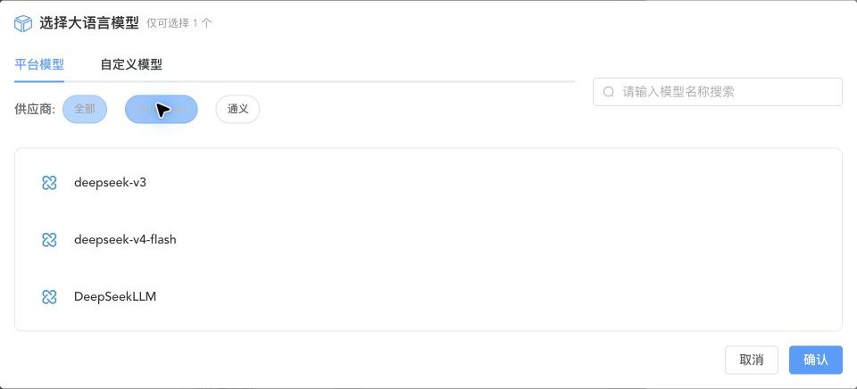

**修改影响：** 模型会影响理解能力、回答风格、响应速度和工具调用能力，也可能影响计时系数。更换模型后，要重新检查参数和技能是否适配，不应直接沿用对另一个模型的效果预期。

「自定义模型」指你已在「模型配置」中添加的模型。列表为空时，需要先完成模型接入；填写过角色介绍并不等于已经接入模型。

**验证方法：** 用同一组问题比较身份遵循、回答长短、等待时间，以及一条需要调用技能的请求。

### 4.2 参数配置 {#llm-presets}

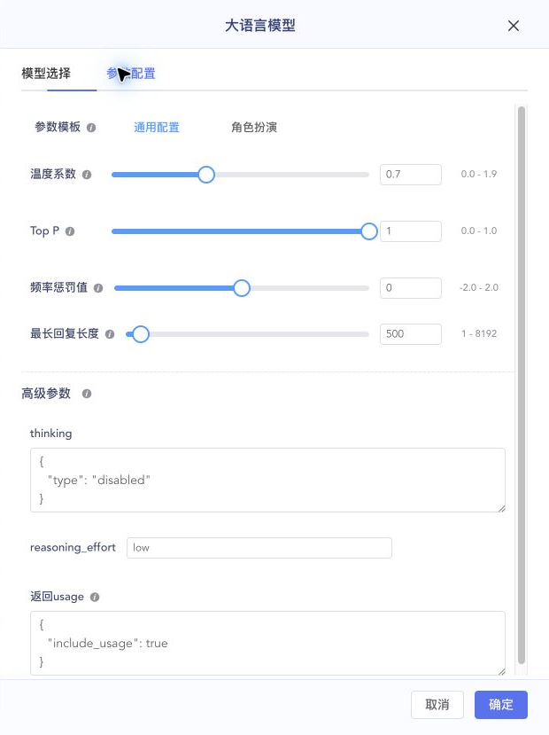

初次使用可以先选择「通用配置」。需要更丰富的表达时，可以比较「角色扮演」模板；具体角色身份仍需写在角色介绍中。

| 参数 | 通用配置 | 角色扮演 |
| --- | --- | --- |
| 温度系数 | 0.7 | 0.9 |
| Top P | 1.0 | 0.9 |
| 频率惩罚值 | 0 | 0 |
| 最长回复长度 | 500 token | 500 token |

选择模板会重设这些参数。「通用配置」还会关闭联网搜索；切换模板后应重新检查相关开关。

| 参数 | 有什么用 | 修改后会怎样 | 调整建议 |
| --- | --- | --- | --- |
| 温度系数 | 调节生成回答时的随机性；页面范围 0～1.9 | 降低通常使表达更稳定，提高通常使表达更有变化；不直接决定事实正确性 | 先用模板值，需要时小幅调整 |
| Top P | 调节生成时考虑的候选范围；页面范围 0～1 | 较低通常更集中，较高允许更多表达变化 | 初次保留 1.0，避免与温度同时大幅修改 |
| 频率惩罚值 | 调节对重复用词的抑制；页面范围 -2～2 | 正值倾向于减少重复，负值可能增加重复；过高可能影响专业术语的自然使用 | 先用 0，确有重复时再小幅提高 |
| 最长回复长度 | 限制单次模型输出的长度；页面范围 1～8192 token | 过小可能导致回复被截断，提高上限可能允许更长的回答 | 希望日常回答简短时，先改角色介绍，再用上限辅助限制 |
| 联网搜索 | 在支持的模型下允许使用搜索能力 | 可为回答提供外部信息，但不保证每次回答都会搜索 | 仅在页面出现此开关且确有需求时开启 |
| 高级参数 | 当前模型特有的设置 | 可能影响思考、推理或返回信息，字段随模型变化 | 不熟悉时保持现有值，按字段说明调整；JSON 输入需保持合法格式 |

token 是模型处理文本的单位，与中文字数或语音时长没有固定的一一对应关系。不同模型对参数的支持不同；如果页面提示「模型无需配置参数」，按该模型的使用方式操作即可。

**验证方法：** 每次只改一项，用同样的问题比较结果。修改完成后点击抽屉「确定」再保存整页；点击「取消」、关闭按钮或按 Esc，会放弃本次尚未确认的模型设置。

## 5. 技能与扩展 {#skills}

点击「技能与扩展」卡片，打开技能与知识库详情。

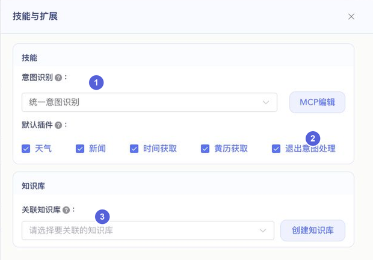

### 5.1 意图识别 {#intent}

图中 ① 决定智能体如何处理需要调用技能的请求，例如查天气、报时间或访问 MCP 服务。

| 选项 | 有什么用、修改影响 | 使用建议 |
| --- | --- | --- |
| 统一意图识别 | 意图识别与聊天使用同一模型，在对话中决定是否调用工具 | 常规技能场景优先考虑，并确认所选聊天模型支持工具调用 |
| 分离意图识别 | 意图识别与聊天使用不同模型，分步调用；选项说明中标注为原「LLM 意图识别」方式、不再推荐 | 已有配置需要时保留，新增配置优先评估统一模式 |
| 无意图识别 | 用于普通聊天，不进行这一类技能调用，MCP 编辑入口会隐藏 | 不需要工具时使用；仅在角色介绍中写「能查天气」不会自动开通能力 |

可选名称以账号页面为准。选择模式后，还要勾选需要的默认插件或关联 MCP 服务。

### 5.2 默认插件 {#builtin-tools}

图中 ② 的勾选项表示允许使用相应能力；是否实际调用，还取决于模型判断、意图识别模式和请求内容。

| 插件 | 修改后的能力 | 测试话术 |
| --- | --- | --- |
| 天气 | 可查询天气信息 | 「今天杭州天气怎么样？」 |
| 新闻 | 可获取新闻信息 | 「给我播报几条新闻。」 |
| 时间获取 | 可查询当前时间 | 「现在几点？」 |
| 黄历获取 | 可查询黄历信息 | 「查一下今天的黄历。」 |
| 退出意图处理 | 可处理主动结束交流的请求 | 「今天先聊到这里，再见。」 |

取消某项勾选后，不再通过该默认插件提供对应能力。若还关联了功能相似的 MCP 或模型搜索，智能体仍可能通过其他已开启的能力回答。

### 5.3 MCP 编辑 {#mcp}

MCP 可以为智能体提供外部工具，例如搜索、地图或音乐服务。点击「MCP编辑」进入下图窗口。

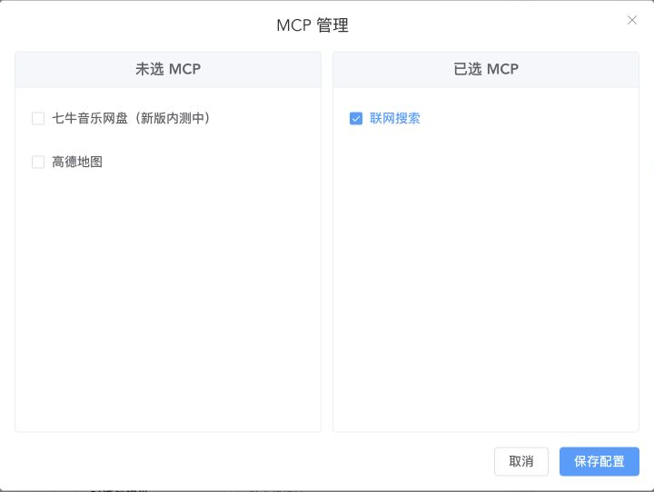

**操作步骤：**

1. 在「未选 MCP」中勾选需要的服务，检查它出现在「已选 MCP」中。
2. 点击窗口内的「保存配置」。取消某项关联时，在已选列表中取消勾选后再保存。
3. 重新连接，提出该服务范围内的明确请求。

**修改影响：** 关联后，智能体可以在需要时尝试调用该服务，不代表每句话都会调用。没有可用服务时，按页面提示去 MCP 市场开通；前往其他页面前，先保存主页面尚未保存的内容。

MCP 关联在窗口中**独立保存**。点击取消或直接关闭，不提交本次选择；已经保存的关联也不会因主页面「重置」而撤销。更多步骤见 [MCP 市场与开通](../mcp/mcp-store.md)。

### 5.4 关联知识库 {#knowledge}

本章开头「技能与扩展」截图中，③ 用于选择当前智能体可以参考的知识库，适合产品客服、说明书问答和展厅讲解。

**操作步骤：**

1. 先准备有明确答案的资料，创建知识库并完成文档处理；已有知识库时可直接选择。
2. 在「关联知识库」中选择需要的知识库，可以关联多个。
3. 在角色介绍中补充回答要求，例如「优先参考提供的产品资料；资料未提到时说明无法确认」。
4. 保存配置，重新连接后测试。

**修改影响：** 关联后，智能体可参考检索到的资料生成回答；不会把所有文档逐字塞进每次回答，也不保证每个问题都能检索到答案。取消关联并保存后，后续新会话不再使用该关联。

**验证方法：** 先问一个答案明确存在于资料中的问题，再问一个资料中没有答案的问题，检查是否能准确引用信息并避免编造。资料准备和检索方法见[知识库最佳实践](./knowledge-start.md)。

## 6. 记忆与隐私 {#memory}

点击「记忆与隐私」，可看到「记忆」和「隐私设置」两个独立模块。

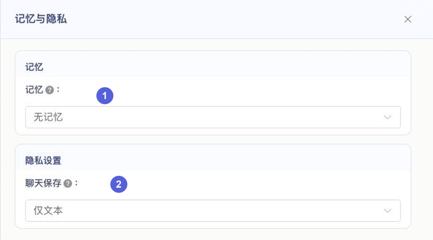

### 6.1 记忆模式 {#memory-mode}

图中 ① 控制是否在后续对话中使用已有偏好等记忆。

| 模式 | 有什么用 | 修改后会怎样 |
| --- | --- | --- |
| 无记忆 | 不启用跨会话记忆 | 同一次对话仍可理解当前上下文；不能把它当作清除已有记录的操作 |
| 长期记忆 | 从交流中提取重要事实和偏好，供后续交流参考 | 后续对话可能结合用户兴趣、称呼等信息作答；不等于逐字保存每句话 |

部分已有配置可能显示其他记忆模式，以当前可选内容为准。

**操作步骤：**

1. 选择「长期记忆」，等待页面准备关联的记忆容器。
2. 出现「编辑记忆容器」后，可以按需设置希望重点记住的「记忆变量」。例如，变量名填「用户昵称」，描述填「记录用户明确希望被称呼的名字」，单值模式用于保留一个当前值。
3. 每行变量分别点击「保存」，主页面的记忆模式也要点击顶部「保存配置」。

**验证方法：** 用同一台设备说「请叫我小林，我喜欢轻音乐」，完成一段交流后正常结束连接，给记忆处理留出时间。再用同一台设备建立新连接，问「我喜欢什么类型的音乐？」。需要核对结果时，在「编辑记忆容器 → 设备记忆检索」输入实际设备的 MAC 地址查询。

实际记忆按设备标识区分，网页体验与实体设备可能使用不同标识。不要用设备 A 写入、设备 B 查询来判断功能是否正常。详细变量设置和检索说明见[长期记忆最佳实践](./longterm-memory-start.md)。

### 6.2 聊天保存 {#privacy}

图中 ② 控制聊天记录的保存内容。

| 选项 | 有什么用、修改影响 | 适合什么情况 |
| --- | --- | --- |
| 不记录 | 后续按此设置不保存聊天记录 | 不需要保留聊天内容时 |
| 仅文本 | 保存聊天文字，不保留对应聊天录音 | 需要回看文字、无需音频时 |
| 文本+语音 | 保存聊天文字和语音记录 | 需要回听，或准备声纹参考录音时 |

选择后保存配置，再用新连接完成一段对话，到聊天记录中检查文字或录音是否符合预期。

::: warning 聊天保存和记忆是两项独立设置
选择「不记录」不等于关闭长期记忆，也不等于删除以前已经保存的聊天或记忆。如果不希望后续使用跨会话记忆，还需要检查记忆模式；已有内容需要在相应管理入口中处理。
:::

## 7. 声纹功能 {#voiceprint}

点击「声纹功能」，可以管理关联说话人，并设置是否仅回应已添加的人。


### 7.1 添加说话人 {#speaker-add}

图中 ① 的「管理说话人」用于录入说话人的称呼、信息及声纹。声纹来自本人录音，填写名字或关系不能代替声音识别。

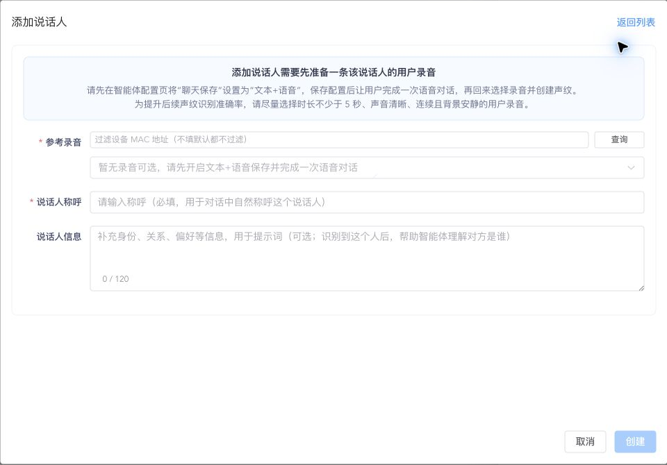

**操作步骤：**

1. 先在「记忆与隐私 → 聊天保存」选择「文本+语音」，保存配置并让设备重新连接。
2. 让需要录入的人完成一次语音对话，准备清晰、连续、背景安静的本人录音，尽量不少于 5 秒。
3. 进入「管理说话人 → 添加说话人」。
4. 在「参考录音」中选择该用户的录音；可填写设备 MAC 地址后查询缩小范围，先试听确认。
5. 填写必填的「说话人称呼」，如「小林」；按需填写「说话人信息」，如关系、偏好或希望使用的称呼。
6. 点击「创建」，确认说话人已出现在当前智能体列表，再进行语音验证。

称呼最多 40 个字符，信息最多 120 个字符。列表中的「编辑」用于更新说话人信息；需要重新录入声音时，可在编辑时选择新的参考录音。

**修改影响：** 成功识别后，智能体可以结合说话人称呼和信息交流。创建、编辑和关联操作在说话人管理中独立提交，关闭窗口不会撤销已经保存的操作。删除前请阅读页面确认提示，其中可能同时涉及移除关联和删除说话人。

### 7.2 仅回应已添加说话人 {#speaker-only}

本章开头声纹详情截图中，② 的开关影响普通语音请求是否继续回答：

- **关闭：** 不使用「是否匹配到已添加说话人」来限制正常回答。
- **开启：** 语音需要成功匹配当前智能体已添加的说话人，才能继续回答。未添加、录音质量不佳或识别失败，都可能导致不回应。

应先完成说话人录入并确认识别正常，再开启此限制并保存配置。验证时，让已添加用户和未添加用户分别说同一句问题；文字消息不能代替声纹语音验证。需要恢复普通交流时，关闭限制、保存并重新连接。

如需通过接口管理说话人、声纹和智能体关联，参见[声纹识别 V2 API](../api/voiceprint-v2.md)。

## 8. 对话与视觉 {#conversation}

点击「对话与视觉」，下图已展开视觉分析的「高级设置」。

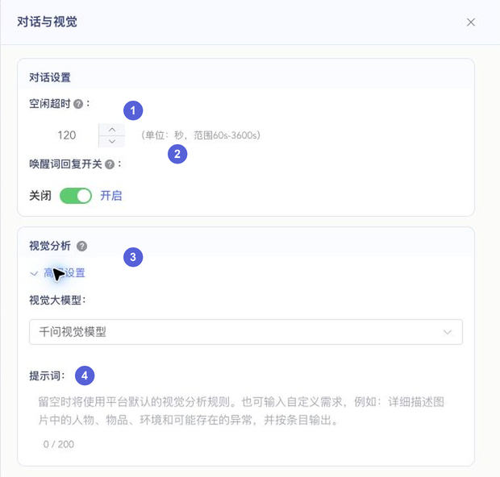

### 8.1 空闲超时 {#idle-timeout}

图中 ① 控制连接长时间空闲后的结束时机，范围 **60～3600 秒**，页面初始值为 **120 秒**。

**修改影响：** 调小后，长时间没有继续交流时会更早结束；调大后，会等待更久，也可能增加连接保持时长。实际判断还考虑会话中的音频等活动，不应理解为「只从用户最后一句话结束开始精确倒计时」。

**验证方法：** 保存并重新连接，完成一轮交流后保持安静，观察结束行为。主动说「再见」能否结束，主要查看[退出意图处理](#builtin-tools)，与空闲超时分别设置。

### 8.2 唤醒词回复开关 {#greeting}

图中 ② 控制识别到唤醒词后，智能体是否进行问候回复。

- **开启：** 可以在唤醒后听到问候，方便确认智能体已经准备好交流。
- **关闭：** 不进行这项唤醒问候，等待用户继续提问；正常问答仍可使用。

它不修改设备的唤醒词，也不等于关闭设备本身的提示音。

**验证方法：** 用实体设备说唤醒词，停顿后再问一个问题，分别检查问候和正常回答。网页拨打不能完全替代硬件唤醒流程的验证。

### 8.3 视觉分析与高级设置 {#vision}

视觉分析用于根据拍摄画面回答问题，如识别物品、描述场景。需要设备或网页体验具备可用的摄像头，并能完成拍照与图片提交。

**操作步骤：**

1. 在图中 ③ 点击「高级设置」。
2. 选择可用的「视觉大模型」，它负责理解图片内容，与普通聊天大模型分别配置。
3. 按需要在图中 ④ 填写视觉提示词，最多 200 个字符。留空时使用平台默认分析规则。
4. 保存配置，重新连接，通过有摄像头的设备或网页体验测试。

视觉提示词示例：

```text
先识别画面中的主要物品，再描述颜色、位置和用途。
看不清或无法确定时明确说明，不猜测图片以外的信息。
```

**修改影响：** 更换视觉模型会影响画面理解表现；修改提示词会影响描述重点和输出方式。仅配置模型并不会自动开启摄像头，画面模糊、未上传或权限未开启时，也无法获得预期结果。

**验证方法：** 对准一件清晰物品，问「你看到了什么？它是什么颜色？」，检查是否基于当前画面回答。设备接入与拍照流程见[拍照功能](./camera-feature.md)。

## 9. 保存、重置与网页体验 {#save-and-test}


### 9.1 保存与生效范围 {#save-scope}

| 你修改了什么 | 怎样保存 | 之后做什么 |
| --- | --- | --- |
| 名称、角色介绍、语言、开关、模型模式、知识库选择 | 页面右上角「保存配置」 | 确认成功后重启设备；网页体验结束旧连接再重新拨打 |
| 大模型与模型参数 | 抽屉「确定」，再保存整页 | 用新连接验证模型和参数 |
| 音色、默认情绪、音量、语速、语调 | 音色窗口「确定」，再保存整页 | 用实际对话验证声音 |
| MCP 关联 | MCP 窗口内「保存配置」，独立提交 | 主页面如有修改，也需另行保存 |
| 说话人的创建、编辑和关联 | 说话人窗口中的对应操作，独立提交 | 核对列表；主页面的限制开关仍需保存 |
| 记忆变量 | 每一行分别点击「保存」，独立提交 | 记忆模式仍需保存整页，再用新对话验证 |

“保存成功”表示配置已提交，不表示正在进行的旧会话已经切换到所有新设置。若出现某个子项保存失败的提示，应检查对应模块。

### 9.2 重置 {#reset}

「重置」会在确认后，将主表单多项字段清空或恢复为页面初始值，例如名称、角色介绍和模型选择。它**不是恢复到上次保存的完整配置**，也不会立即替你保存重置后的表单。

如果只是想放弃本次未保存的主表单修改，可以重新进入配置页读取已保存内容。MCP、记忆变量、说话人等已经独立提交的操作，不会因此撤销。

### 9.3 网页体验 {#preview}


右侧体验区用于快速检查角色、回答和声音。准备好麦克风与扬声器后，点击「拨打」，按浏览器提示允许使用麦克风。

::: warning 拨打前会自动保存当前配置
点击「拨打」时，页面会先保存当前配置，再建立连接。体验前请先检查表单，避免把临时尝试的内容一并保存到正在使用的智能体。
:::

接通后的常用操作：

- **按住说话、松开静音：** 按住麦克风按钮期间讲话，松开后恢复静音。只接通后直接讲话，可能没有发送语音。
- **查看文字与状态：** 先看语音有没有识别正确，再判断回答内容和播报是否正常。
- **挂断：** 结束当前测试连接。改完配置后，先结束旧连接再拨打。
- **启用摄像头：** 需要浏览器摄像头权限，用于测试网页拍照；不控制实体设备的摄像头。

网页验证通过后，仍建议用实际设备检查拾音、音量、网络和摄像头等效果。

### 9.4 预计扣减倍率 {#billing}

在配置入口列表底部，将鼠标移到「预计扣减倍率」上，可以查看当前配置的明细和完整规则链接。

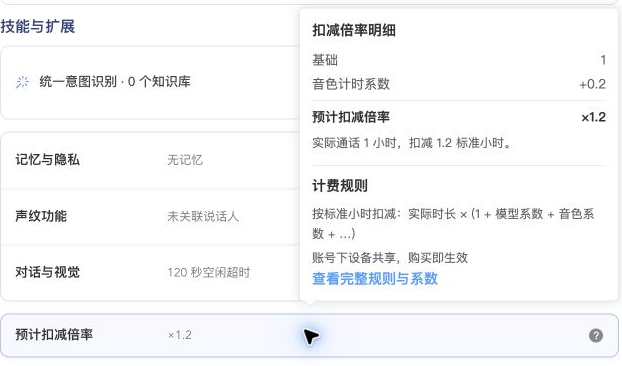

**修改影响：** 更换大模型或音色后，预计倍率可能随相应计时系数变化。使用 UID 小时资源包时，倍率用于将设备会话时长折算为扣减时长；不是按用户或智能体实际说话的秒数计算。

例如，在适用该资源包计时的情况下，倍率为 ×1.2，设备会话持续 60 分钟，预计折算为 72 分钟资源包时长。新配置从后续新建立的会话开始生效。具体适用范围、结算和系数以[资源包时长扣减规则](../billing/resource-usage-billing.md)及实际用量记录为准。

## 10. 首次配置步骤 {#quick-setup}

1. **先设置身份。** 填写名称和助手昵称，选模板或编写角色介绍，说明它是谁、为谁服务、应该怎样回答。
2. **再设置语言与声音。** 先选对话语言，再选择音色，试听后确认。
3. **选择大语言模型。** 初次使用先保留通用参数，确认模型可用。
4. **按需要加能力。** 普通聊天可先保留其他设置；确需查天气、参考资料或记住偏好时，再逐项配置技能、知识库和记忆。
5. **保存并重新连接。** 设备重启后测试；网页体验结束旧连接再拨打。
6. **分开验证。** 依次问「你叫什么名字？」「用两句话介绍一下你的工作」，再测试一项已配置的技能。每次集中调整一类设置，更容易比较修改效果。

## 11. 常见问题 {#faq}

| 现象 | 按什么顺序检查 |
| --- | --- |
| 改了昵称，仍叫旧名字 | 角色介绍是否写死旧名字 → 是否引用助手昵称 → 是否保存并重新连接 |
| 改了语言，声音也变了 | 语言切换会尝试联动选择音色 → 重新检查音色、默认情绪并保存 |
| 回答太长或说到一半结束 | 先检查角色介绍的回答要求 → 再检查最长回复长度 → 排除打断或连接中断 |
| 改了语速，试听没变化 | 试听是示例音频 → 保存后用实际对话验证 → 检查该音色的参数支持 |
| 配了天气或 MCP，却不调用 | 意图识别模式 → 模型是否支持工具调用 → 插件或 MCP 是否已保存 → 请求是否清楚 |
| 选择不记录，仍能记住偏好 | 区分当前会话上下文与长期记忆 → 检查记忆模式 → 不把不记录当成删除已有内容 |
| 声纹找不到参考录音 | 先选择文本+语音并保存 → 新连接完成用户语音对话 → 检查设备筛选范围 |
| 开启仅回应说话人后不回答 | 检查录入与关联 → 检查录音和识别 → 需要时关闭限制、保存后重连 |
| 网页接通后没有识别文字 | 是否按住说话 → 麦克风权限和输入设备 → 录音环境 |
| 保存后没有变化 | 主页面与独立窗口是否分别保存 → 是否仍在旧连接 → 是否在对应智能体绑定的设备上测试 |

## 12. 相关操作文档 {#related}

- [快速入门与设备绑定](./quick-start.md)
- [长期记忆最佳实践](./longterm-memory-start.md)
- [知识库最佳实践](./knowledge-start.md)
- [MCP 市场与开通](../mcp/mcp-store.md)
- [声纹识别 V2 API](../api/voiceprint-v2.md)
- [拍照功能](./camera-feature.md)
- [资源包时长扣减规则](../billing/resource-usage-billing.md)
