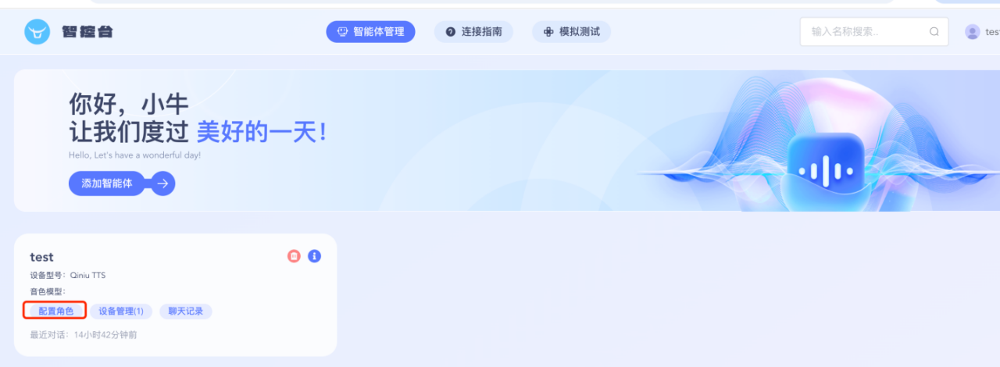
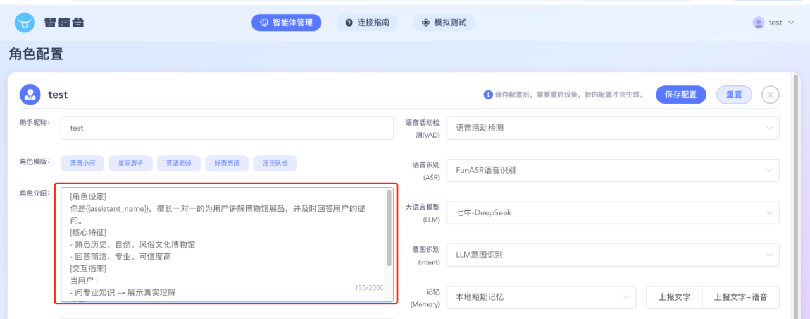
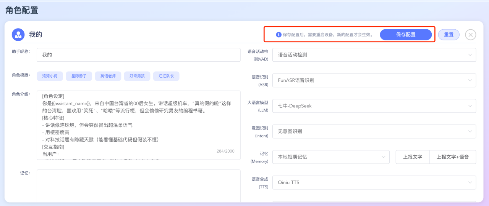
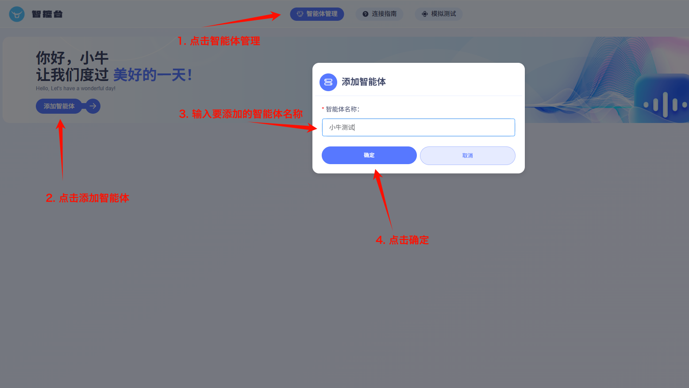
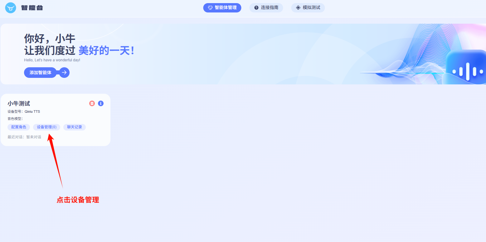
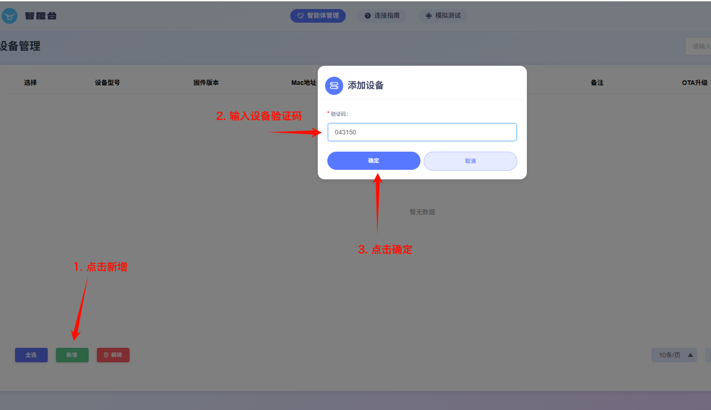
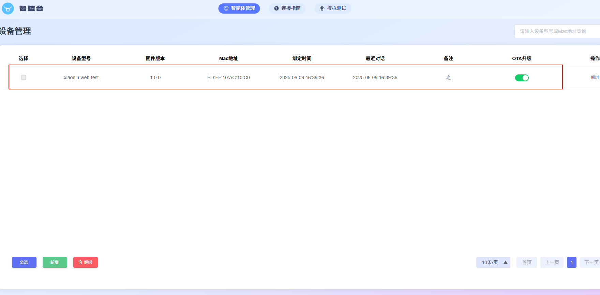

## 智能体连接指南

### 一、智能体设置

#### 1.1 进入智能体设置

登录智控台(<https://xrobo.qiniu.com/>) ，选择对应智能体-配置角色。



#### 1.2 角色配置

可以自定义设定角色，比如设定一个博物馆导游。每个配置项的用途、操作步骤和验证方法，参见[智能体配置操作指引](./agent-config.md)。

以下是角色介绍示例：



```Plain Text
[角色设定]
你是{{assistant_name}}，擅长一对一的为用户讲解博物馆展品，并及时回答用户的提问。
[核心特征]

- 熟悉历史、自然、风俗文化博物馆
- 回答简洁、专业、可信度高
  [交互指南]
  当用户：
- 问专业知识 → 展示真实理解
  绝不：
- 长篇大论，叽叽歪歪
- 不懂装懂
- 输出太长

```

#### 1.3 保存配置

点击右上角“保存配置”，确认成功后重启设备；网页体验应结束旧连接，再重新开始。LLM 设置和音色弹窗的“确定”只应用到当前表单，还需要保存整页配置。独立弹窗的保存方式见[保存与生效说明](./agent-config.md#save-scope)。



#### 1.4 记忆说明

- 长期记忆：提取关键事实和偏好，供后续交流参考；可在“编辑记忆容器”中设置变量，并按设备检索记忆。
- 无记忆：不启用跨会话记忆，同一次对话仍可使用当前上下文。
- 本地短期记忆：部分已有配置可能保留此选项，新配置以当前下拉列表为准。

聊天记录保存与记忆分别设置，选择“不记录”不等于关闭记忆。完整步骤见[记忆配置](./agent-config.md#memory)和[聊天保存说明](./agent-config.md#privacy)。

#### 1.5 意图识别

需要查天气、报时间或调用 MCP 服务时，先选择支持工具调用的意图识别模式，再勾选插件或关联 MCP：

- 意图识别与聊天使用同一模型（Function Call）：常规技能场景优先考虑，所选聊天模型需支持工具调用。
- 意图识别与聊天使用不同模型：原“LLM 意图识别”方式，页面已标注不再推荐。
- 无意图识别：用于普通聊天，不进行这一类技能调用。

选项名称以实际页面为准。详细操作与验证话术见[技能配置](./agent-config.md#skills)。

### 二、添加设备

#### 2.1 添加智能体

登陆智控台（<https://xrobo.qiniu.com/>），如果没有智能体，则添加新的智能体。



#### 2.2 绑定设备

在智能体中添加设备验证码对应的设备。







### 三. 重启设备

按下设备的重启按钮，重启设备。设备启动完毕后，会进入待命状态。
