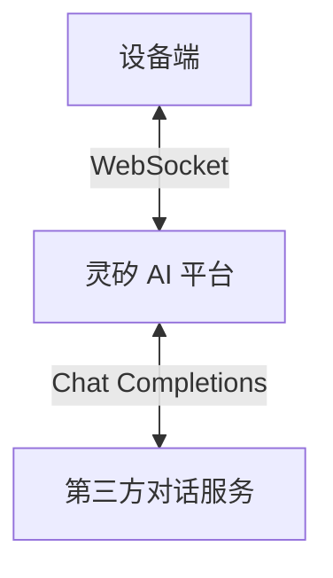

# 第三方业务系统接入指南

灵矽 AI 平台通过自定义模型，将对话消息转发至第三方对话服务。本文说明模型配置、请求格式和返回要求。

## 1. 接入方式

### 1.1 系统架构



### 1.2 职责划分

- **设备端**：采集和播放音频，执行设备控制指令。
- **灵矽 AI 平台**：管理设备连接，完成语音识别、对话调用和语音合成。
- **第三方对话服务**：接收对话消息并返回流式文字回复。

### 1.3 请求链路

1. 设备通过 WebSocket 发送语音。
2. 平台完成语音识别，组织对话消息。
3. 平台以 OpenAI Chat Completions 格式向第三方对话服务发起流式请求。
4. 第三方对话服务返回 SSE 流式文字。
5. 平台将文字合成为语音并下发设备。

## 2. 对话服务接入

第三方对话服务实现 OpenAI Chat Completions 兼容接口。平台发送对话消息，接收流式文字回复，并完成语音合成和设备播放。

### 2.1 配置模型

在「我的模型」中创建模型，供应器选择「OpenAI 接口」，填写以下配置，然后在目标智能体中选择该模型并保存。

| 配置项 | 说明 | 示例 |
| --- | --- | --- |
| `type` | 供应器类型 | `openai` |
| `base_url` | 对话服务基础地址，不含 `/chat/completions` | `https://api.example.com/v1` |
| `model_name` | 对话服务识别的模型名称 | `business-assistant` |
| `api_key` | 对话服务的调用密钥，必填 | 由服务方提供 |

平台在 `base_url` 后追加 `/chat/completions`。以上配置对应的请求地址为 `https://api.example.com/v1/chat/completions`。

通过 API 创建模型和绑定智能体，参见[大语言模型 API](../api/llm.md)与[智能体 API](../api/agent.md)。

### 2.2 请求格式

**调用方向**：灵矽 AI 平台 → 第三方对话服务。

```http
POST {base_url}/chat/completions
Content-Type: application/json
Authorization: Bearer {api_key}
```

平台调用对话模型时，如可获取设备和智能体标识，会携带以下 Header：

| Header | 说明 |
| --- | --- |
| `X-Linx-Device-Id` | 当前设备 ID |
| `X-Linx-Agent-Id` | 当前智能体 ID |

业务服务应使用 `Authorization` 校验调用权限，设备和智能体标识不作为鉴权凭据。

**请求示例**：

```bash
curl --no-buffer -X POST 'https://api.example.com/v1/chat/completions' \
  -H 'Content-Type: application/json' \
  -H 'Authorization: Bearer YOUR_API_KEY' \
  -d '{
    "model": "business-assistant",
    "messages": [
      {"role": "system", "content": "你是业务助手。"},
      {"role": "user", "content": "你好"}
    ],
    "stream": true,
    "max_tokens": 1024,
    "temperature": 0.7,
    "top_p": 1.0,
    "frequency_penalty": 0.0
  }'
```

| 字段 | 类型 | 说明 |
| --- | --- | --- |
| `model` | string | 模型配置中的 `model_name` |
| `messages` | array | 对话消息，包含角色、内容及本次请求所需的上下文 |
| `stream` | boolean | 流式对话为 `true` |
| `max_tokens` | integer | 输出 token 数上限 |
| `temperature`、`top_p`、`frequency_penalty` | number | 生成参数，取值由模型与智能体配置确定 |

服务应根据 `messages` 处理多轮对话。

### 2.3 流式响应

返回 HTTP `200`，`Content-Type` 为 `text/event-stream`。文字内容放在 `choices[0].delta.content` 中：

```text
data: {"choices":[{"index":0,"delta":{"role":"assistant","content":"你好，"},"finish_reason":null}]}

data: {"choices":[{"index":0,"delta":{"content":"有什么可以帮你？"},"finish_reason":null}]}

data: {"choices":[{"index":0,"delta":{},"finish_reason":"stop"}]}

data: [DONE]

```

- 每条 `data:` 行包含一个完整 JSON，事件之间以空行分隔。
- 回复结束后发送 `data: [DONE]`。
- 平台将回复文字合成为语音；音色在智能体中配置，参见[语言与音色设置](./agent-config.md#language-and-voice)。

### 2.4 错误处理

开始流式响应前发生鉴权失败、服务不可用等错误时，返回相应的非 `200` HTTP 状态。

流式响应开始后发生错误时，返回以下格式并结束响应流：

```text
data: {"error":{"message":"Service temporarily unavailable","type":"server_error","code":"service_unavailable"}}

```

服务应处理客户端断开，及时释放请求资源。错误信息不得包含密钥或其他敏感数据。

## 3. 相关文档

- [WebSocket 协议](../platform/websocket.md)：设备通信协议。
- [大语言模型 API](../api/llm.md)：自定义模型与生成参数配置。
- [智能体配置指引](./agent-config.md)：模型、音色与技能设置。
