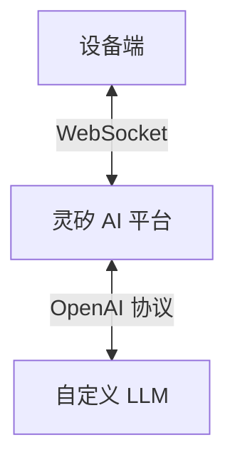

# 自定义 LLM 接入

将自有的大语言模型服务接入灵矽 AI 平台后，平台会把对话消息转发给该服务，并使用其返回的文字进行语音合成。

## 1. 接入方式

### 1.1 系统架构

### 1.2 请求链路

1. 设备通过 WebSocket 发送语音或文本。
2. 平台完成语音识别（语音输入时），组织对话消息。
3. 平台按 OpenAI 协议调用自定义 LLM。
4. 自定义 LLM 返回文字回复。
5. 平台将文字合成为语音并下发设备。

## 2. 配置自定义 LLM

在「我的模型」中创建模型，供应器选择「OpenAI接口」，并填写以下配置：

| 配置项 | 说明 |
| --- | --- |
| `type` | 供应器类型，选择 `openai` |
| `base_url` | 自定义 LLM 服务地址 |
| `model_name` | 模型或服务标识 |
| `api_key` | 服务调用密钥 |

自定义 LLM 需兼容 OpenAI 协议，平台将按该协议发起对话请求。配置完成后，在目标智能体中选择该模型并保存。

通过 API 创建模型和绑定智能体，参见[大语言模型 API](../api/llm.md)与[智能体 API](../api/agent.md)。

## 3. 相关文档

- [WebSocket 协议](../platform/websocket.md)：设备通信协议。
- [大语言模型 API](../api/llm.md)：自定义模型配置。
- [智能体配置指引](./agent-config.md)：模型、音色与技能设置。
